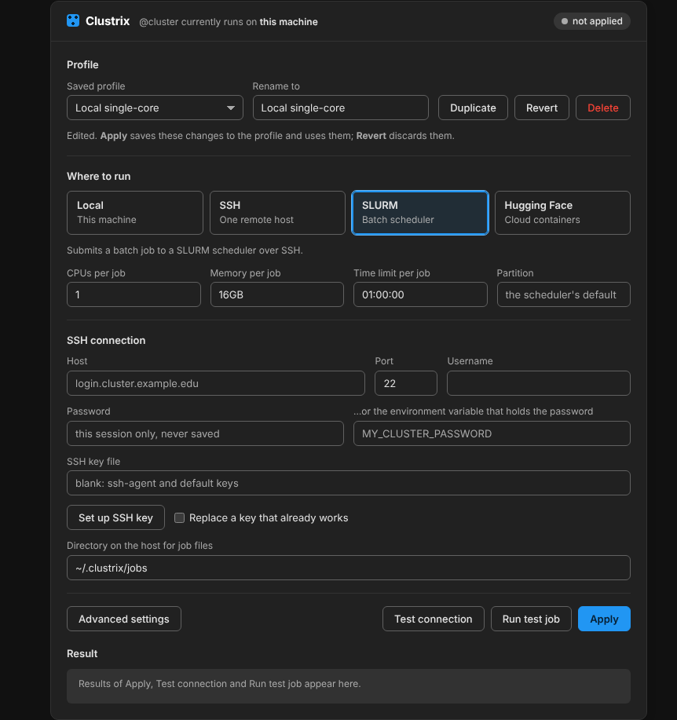

# Clustrix

[](https://github.com/ContextLab/clustrix/actions/workflows/tests.yml)
[](https://pypi.org/project/clustrix/)
[](https://clustrix.readthedocs.io/en/latest/?badge=latest)
[](https://www.python.org/downloads/)
[](https://opensource.org/licenses/MIT)

Clustrix runs an ordinary Python function somewhere else. Put `@cluster` on
the function and call it as usual: the function, its arguments and the
project code it uses are sent to the machine you configured, it runs there,
and the call returns the function's return value.

```python
# cluster-required: needs a SLURM login node you can reach over SSH
from clustrix import cluster, configure

configure(
    cluster_type="slurm",
    cluster_host="login.cluster.example.edu",
    username="researcher",
    remote_work_dir="/scratch/researcher/clustrix",
)

@cluster(cores=1, memory="1GB", time="00:05:00")
def where_am_i():
    import getpass, platform
    return f"{getpass.getuser()}@{platform.node()}"

print(where_am_i())   # runs as a SLURM job; prints e.g. researcher@node017
```

The four things below are what the library does beyond that. Every output
shown in this file was produced by running the example: the local ones on a
4-CPU Linux machine, the remote ones against a real `sshd` and a single-node
SLURM installation, with the host name, user and paths replaced by
placeholders afterwards. The first job on a new host builds a Python
environment there (27 s in our run); later jobs reuse it (3 s).

## 1. A loop is divided automatically

If the decorated function has a `for` loop whose iterations do not depend on
each other, Clustrix runs the iterations in parallel and returns exactly what
the function would have returned. Nothing about the function changes.

```python
import math
import clustrix
from clustrix import cluster, configure

configure(cluster_type="local")

@cluster(cores=4)
def simulate(seeds):
    totals = []
    for seed in seeds:
        total = 0.0
        for i in range(1, 2_000_000):
            total += math.sin(seed + i) / i
        totals.append(total)
    return max(totals)

print(clustrix.explain(simulate))
print(simulate(range(8)))
```

```text
simulate:
  line 11: `for seed in seeds` -- SPLIT
      collected in order: totals
      private to each iteration: i, seed, total
  code before the loop runs in the caller
  code after the loop runs in the caller
1.0707961452150196
```

`clustrix.explain(function)` reports the decision without running anything.
When a loop cannot be divided it names the line and the reason:

```text
running_total:
  line 11: `for value in values` -- not split
      line 12: total is read before the iteration assigns it, so it carries a value from the previous iteration
```

Where the pieces run depends on the backend:

- **Locally**, `cores` is the number of worker processes (`cores=-1` uses
  every CPU available to the process). The first call of a function divides
  its loop and measures what an iteration costs; a later call whose loop is
  too short to be worth dividing runs in the calling process.
- **On `ssh` and `slurm`**, each piece is one job with the resources the
  decorator names, at most `max_parallel_jobs` of them. The same function as
  eight iterations on SLURM with `max_parallel_jobs=4`, returning the job ID
  each iteration saw:

  ```text
  [(0, '196'), (1, '196'), (2, '197'), (3, '197'), (4, '198'), (5, '198'), (6, '199'), (7, '199')]
  ```

## 2. Input files are staged automatically

On `ssh` and `slurm`, a local file the call names is uploaded once and made
available at the path the code uses.

```python
# cluster-required: needs an SSH host; data/scores.csv exists only locally
import csv
from clustrix import cluster, configure

configure(
    cluster_type="ssh",
    cluster_host="gpu-box.example.edu",
    username="researcher",
)

@cluster(cores=1, memory="1GB")
def mean_score():
    import socket
    with open("data/scores.csv") as handle:
        rows = list(csv.DictReader(handle))
    return socket.gethostname(), sum(float(r["score"]) for r in rows) / len(rows)

print(mean_score())
```

```text
INFO clustrix.auto_stage: Input /home/researcher/project/data/scores.csv (32 B): uploaded as /home/researcher/.clustrix/jobs/data/5e2f56d95eac994f5c60/scores.csv
('gpu-box', 2.6666666666666665)
```

Paths are found among the arguments and among the string constants in the
function and the project code it calls. A path that is only computed at run
time cannot be found; list it with `@cluster(data=[...])` or pass it as an
argument. `@cluster(no_data=[...])` keeps a path out. The full rules are in
[Input files](https://clustrix.readthedocs.io/en/latest/input_files.html).

## 3. Code and dependencies travel with the job

The function is serialized by value, so functions defined in a script, a
notebook or the REPL work. Modules from your own project are sent with it.
The packages the function imports are detected and installed in an
environment on the remote host, which is cached and reused. By default the
whole local environment is mirrored; `configure(replicate_local_environment=False)`
installs only what was detected. The remote Python must be the same minor
version as the local one; a mismatch is refused when the job is submitted.

## 4. A notebook widget

In a Jupyter notebook:

```ipython
%load_ext clustrix
```

```ipython
%%remote
```



The form is a draft of a saved profile. **Apply** saves it and makes
`@cluster` use it; **Revert** discards the edits. **Test connection** and
**Run test job** make a real connection and run a real job. A host that has
not been seen before shows its key fingerprint and a **Trust this host**
button. Passwords and tokens typed into the form are kept for the session
and never written to a profile; see the
[security note](https://clustrix.readthedocs.io/en/latest/api/notebook_magic.html#security-note)
about notebooks that save widget state.

## What it cannot do

Loop division:

- Only a `for` loop (or a statement that is a single-`for` comprehension) at
  the top level of the decorated function is considered. A loop inside a
  helper the function calls, or nested under `if`/`with`/`try`, is not divided.
- A loop is not divided when an iteration uses a value from the previous one,
  contains `break` or `return`, assigns a variable that is used after the
  loop, writes a global, or draws from the unseeded global `random`/NumPy
  generator. The function then runs as one unit, with a message saying why.
- The analysis reads source code and cannot see what a called function does.
  Run-time checks catch a shared object being modified and the global random
  state moving, and fall back to the sequential loop. **Nothing detects state
  outside the values the loop was given**: a module-level cache, a file, a
  database, or a GPU's random state. Such side effects still happen once per
  iteration, in an unspecified order.
- There are no SLURM job arrays yet: each piece of a divided loop is its own
  `sbatch` submission.
- No GPU path has been verified on real hardware in this release.
  `auto_gpu_parallel` is accepted and does nothing.

Files:

- Automatic staging applies to `ssh` and `slurm`, not to HuggingFace Jobs and
  not to `async_submit=True`.
- A path that appears in code is staged only if it is inside the project (the
  git top level, otherwise the working directory). Credential files are
  refused. A call that would upload more than `auto_stage_max_bytes` (1 GB)
  stops and lists the sizes.
- **Files a job writes are not brought back.** Only the return value is.
- Staged data is never deleted automatically.

Backends: the list below is complete.

## Supported backends

| `cluster_type` | Status |
|-|-|
| `slurm` | Verified end to end against a real scheduler |
| `ssh` | Verified end to end against a real GPU host |
| `huggingface` | Verified end to end against real HF Jobs containers |
| `local` | Runs on the calling machine |

Evidence for the verified rows is regenerated by
`scripts/verify_cluster_usecases.py` and committed under
[docs/evidence/](docs/evidence/).

Not supported. Naming one of these in `cluster_type` raises a `ValueError`
that names the tracking issue:

| Not supported | Issue |
|-|-|
| PBS | [#140](https://github.com/ContextLab/clustrix/issues/140) |
| SGE | [#141](https://github.com/ContextLab/clustrix/issues/141) |
| Kubernetes | [#142](https://github.com/ContextLab/clustrix/issues/142) |
| AWS | [#143](https://github.com/ContextLab/clustrix/issues/143) |
| GCP | [#144](https://github.com/ContextLab/clustrix/issues/144) |
| Azure | [#145](https://github.com/ContextLab/clustrix/issues/145) |
| Lambda Cloud | [#146](https://github.com/ContextLab/clustrix/issues/146) |

Cost monitoring, the cloud pricing API and a HuggingFace **Spaces** provider
are absent as well. `cluster_type="huggingface"` means HuggingFace **Jobs**.

## Install

```bash
pip install clustrix              # the library and the `clustrix` command
pip install "clustrix[widget]"    # plus the Jupyter widget
```

Python 3.10 to 3.13. The remote side needs Python of the same minor version
and either `venv` or conda.

## Configure

In Python, for the current process:

```python
from clustrix import configure, get_config

configure(cluster_type="local", default_cores=2)
print(get_config().cluster_type, get_config().default_cores)
```

From the shell, saved to `~/.clustrix/config.yml` for every later process:

```console
$ clustrix config --cluster-type slurm --cluster-host login.cluster.example.edu --username researcher --cores 2
Configuration updated successfully!
Configuration saved to /home/researcher/.clustrix/config.yml
$ clustrix status
Cluster Status:
  Type: slurm
  Host: login.cluster.example.edu
  User: researcher
  Connection: ✓ Connected
```

`clustrix status` exits with status 1 when the connection fails.
`configure()` checks names, types and ranges and changes nothing if any
value is refused. There is no `CLUSTRIX_<FIELD>` environment-variable
overlay; `CLUSTRIX_CONFIG_DIR` only moves the configuration directory.

### First connection to a host

Host keys are verified. A host that is not in `known_hosts` is refused with
its fingerprint and the command that adds it:

```text
Host key verification failed for '[login.cluster.example.edu]:22': this host is not in your known_hosts file(s), so clustrix refused the connection rather than risk a machine-in-the-middle attack.
  Offered key: ssh-ed25519 SHA256:t71ZfprzQXrLFRY47Bhv+RehzAB+NGmKLeKfi1cK//c

To fix this:
  1. If you recognize and trust this host, add its key with:
       ssh-keyscan -p 22 login.cluster.example.edu >> ~/.ssh/known_hosts
     then retry.
```

Connecting once with `ssh` and accepting the key does the same thing. In the
notebook widget, press **Trust this host** after checking the fingerprint.

### HuggingFace Jobs

Not executed in this documentation build (it needs a HuggingFace token).

```python
# cluster-required: needs a HuggingFace token with access to Jobs
from clustrix import cluster, configure

configure(cluster_type="huggingface", hf_namespace="my-org")

@cluster(cores=2, hf_flavor="cpu-basic", hf_timeout="10m")
def where_am_i():
    import platform
    return platform.node(), platform.python_version()

print(where_am_i())
```

The token is read from `hf_token`, `HF_TOKEN` or `hf auth login`. A hardware
flavor that does not start with `cpu-` is refused unless
`hf_allow_gpu_flavors=True`, because those are billed per second.

## Documentation

- [Quickstart](https://clustrix.readthedocs.io/en/latest/quickstart.html)
- [Loop parallelisation](https://clustrix.readthedocs.io/en/latest/parallel_loops.html)
- [Input files](https://clustrix.readthedocs.io/en/latest/input_files.html)
  and [declared data packages](https://clustrix.readthedocs.io/en/latest/data_packages.html)
- [Configuration reference](https://clustrix.readthedocs.io/en/latest/configuration.html)
- [Command line](https://clustrix.readthedocs.io/en/latest/cli.html)
- [SSH setup and host keys](https://clustrix.readthedocs.io/en/latest/ssh_setup.html)
- [Limitations](https://clustrix.readthedocs.io/en/latest/limitations.html)
- [Changelog](CHANGELOG.md)

## Development

```bash
pip install -e ".[dev]"
pytest tests/ -m "not real_world" --ignore=tests/real_world --ignore=tests/integration
python scripts/pre_push_check.py
```

See [CONTRIBUTING.md](CONTRIBUTING.md). `tests/integration/` provisions
billable AWS resources and refuses to run unless `CLUSTRIX_ALLOW_BILLABLE=1`.

## License

MIT. See [LICENSE](LICENSE).
