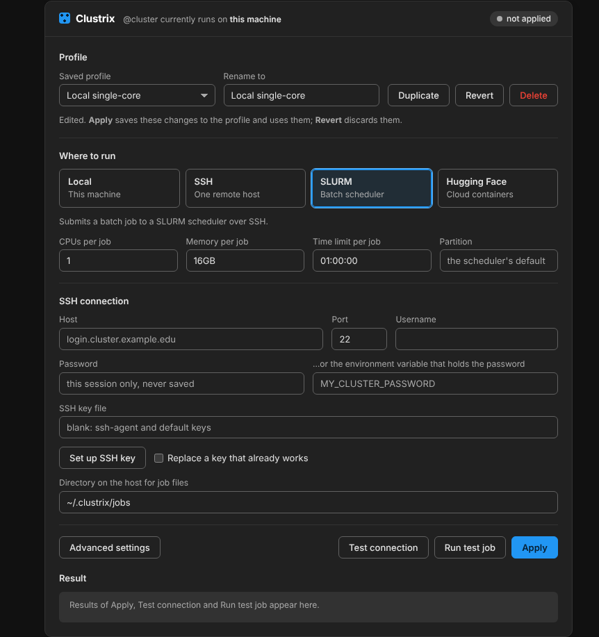
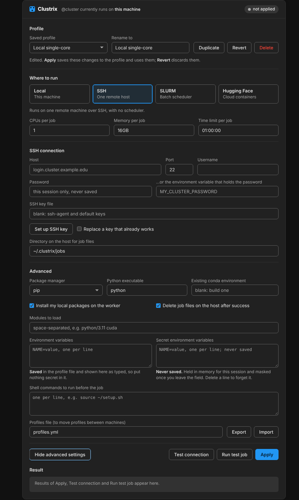
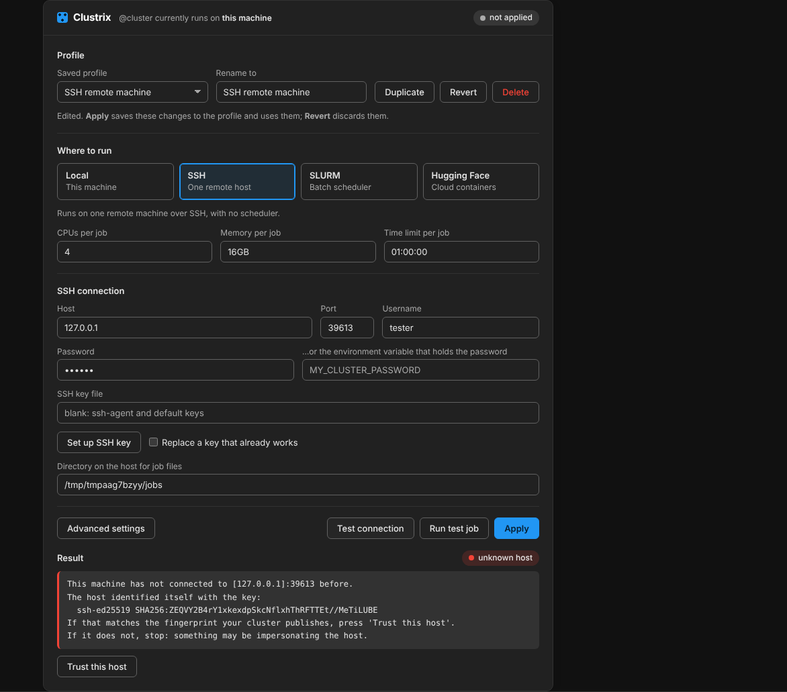

Notebook magics and the widget
==============================

Install the widget's dependencies with ``pip install "clustrix[widget]"``.

Magics
------

.. code-block:: ipython

   %load_ext clustrix

``%load_ext clustrix`` registers the magics below and puts ``cluster``,
``configure`` and ``get_config`` in the notebook's namespace if those names
are free. ``import clustrix`` also registers the magics. Neither displays
anything.

.. list-table::
   :header-rows: 1
   :widths: 34 66

   * - Magic
     - Effect
   * - ``%%remote``
     - Shows the configuration widget, then runs the rest of the cell as
       ordinary code.
   * - ``%clustrix status``
     - Prints the backend ``@cluster`` would use now and its default
       resources; for ``ssh`` and ``slurm`` also the host, user and work
       directory. The backend is the one in effect, not the ``cluster_type``
       field: with no ``cluster_host`` an ``ssh`` or ``slurm`` configuration
       runs the function in this process, and is reported as ``local (no
       cluster host set; cluster_type is 'slurm')``. Returns nothing.
       ``%clustrix`` alone does the same.
   * - ``%clustrix config``
     - Prints the same summary and returns the ``ClusterConfig``.
   * - ``%clustrix config <profile>``
     - Makes a saved profile the live configuration. The profile replaces
       the configuration; it is not merged into it.
   * - ``%clustrix load <file>``
     - Loads a YAML or JSON configuration file.
   * - ``%%clusterfy``
     - Deprecated alias for ``%%remote``. It works and emits a
       ``DeprecationWarning``.

Every form except ``status`` returns the resulting ``ClusterConfig`` (IPython
shows it as the result of the line), or ``None`` when the command was
refused. From a real IPython session, with the returned values left out:

.. code-block:: text

   In [1]: %load_ext clustrix

   In [2]: %clustrix status
   backend      : local
   resources    : 4 cores, 8GB, 01:00:00

   In [3]: %clustrix config nope
   ❌ No profile named 'nope'. Available: HuggingFace Jobs (CPU), HuggingFace Jobs (GPU), Local all cores, Local single-core, SLURM cluster, SSH remote machine

   In [4]: c = %clustrix config Local all cores
   ✅ Applied profile 'Local all cores'

   In [5]: print(c.cluster_type, c.default_cores, c.cluster_host)
   local -1 None

   In [6]: %clustrix frobnicate
   ❌ Unknown command 'frobnicate'. Try: status | config | config <profile> | load <file>

``%clustrix load`` with a file that does not exist raises
``FileNotFoundError``.

Setting the environment variable ``CLUSTRIX_AUTO_WIDGET=1`` before importing
Clustrix makes the widget appear on import. By default it does not.

The widget
----------

There is one widget, :class:`clustrix.ModernClustrixWidget`.

Three things are kept apart
~~~~~~~~~~~~~~~~~~~~~~~~~~~

* **The live configuration**: what ``@cluster`` uses now. The header names
  it ("@cluster currently runs on ...").
* **Saved profiles**: named configurations on disk.
* **The form**: a *draft* of the selected profile. Editing a field changes
  neither the profile nor the live configuration.

**Apply** saves the draft to the profile and makes it the live configuration
in one step. **Revert** discards the draft. A draft survives switching to
another profile and back for as long as the widget exists.

Two indicators
~~~~~~~~~~~~~~

* The pill in the header says only whether the form is what ``@cluster`` is
  using: *applied* or *not applied*.
* The pill beside the **Result** console reports the outcome of the last
  action (for example *connected*, *unknown host*, *export failed*).

Controls
~~~~~~~~

.. list-table::
   :header-rows: 1
   :widths: 28 72

   * - Control
     - What it does
   * - Saved profile, Rename to, Duplicate, Delete
     - Choose, rename, copy and remove profiles. Six are provided at first:
       Local single-core, Local all cores, SLURM cluster, SSH remote machine,
       HuggingFace Jobs (CPU) and HuggingFace Jobs (GPU). **Duplicate** copies
       what is on screen except a password or token that was entered: those
       are not copied, are no longer held afterwards, and the result panel
       says so.
   * - Where to run
     - One tile per supported backend: Local, SSH, SLURM, Hugging Face. The
       tiles are built from ``clustrix.config.SUPPORTED_CLUSTER_TYPES``.
   * - CPUs per job, Memory per job, Time limit per job
     - ``default_cores``, ``default_memory``, ``default_time``.
   * - Partition
     - ``default_partition`` (SLURM only).
   * - Host, Port, Username
     - ``cluster_host``, ``cluster_port``, ``username`` (SSH and SLURM).
   * - Password
     - Used for this session only. Never written to a profile.
   * - ...or the environment variable that holds the password
     - ``password_env_var``.
   * - SSH key file
     - ``key_file``. Blank means the SSH agent and the default keys.
   * - Set up SSH key
     - Generates a key and installs it on the host, using the password above
       once. "Replace a key that already works" forces a new key.
   * - Directory on the host for job files
     - ``remote_work_dir``.
   * - Namespace, Hardware, Time limit per job, Token
     - HuggingFace Jobs: ``hf_namespace``, ``hf_flavor``,
       ``hf_job_timeout``, and a token used for this session only.
   * - Allow GPU hardware, which is billed per second
     - ``hf_allow_gpu_flavors``.
   * - Test connection
     - Connects and authenticates through the same code a job uses, without
       running a job.
   * - Run test job
     - Runs one small job end to end and shows where it ran.
   * - Trust this host
     - Appears when a connection is refused because the host is unknown; see
       below.

**Advanced settings** adds: Package manager, Python executable, Existing
conda environment (``conda_env_name``), "Install my local packages on the
worker" (``replicate_local_environment``), "Delete job files on the host
after success" (``cleanup_on_success``), Modules to load, the two
environment-variable fields described below, Shell commands to run before
the job, and the profiles file with **Export** and **Import**.

Variables for the job go in one of two fields, side by side, and which one
decides what happens to the value:

.. list-table::
   :header-rows: 1
   :widths: 24 38 38

   * -
     - Environment variables
     - Secret environment variables
   * - Setting
     - ``plain_environment_variables``
     - ``environment_variables``
   * - In the field
     - shown exactly as typed
     - ``NAME=••••`` once the field is left
   * - On **Apply**
     - saved in the profile, in plain text
     - kept in memory for this session; never written
   * - Export / Import
     - travel with the profile
     - not in the file
   * - **Duplicate**
     - copied to the new profile
     - not copied, and no longer held
   * - Notebook saved with widget state
     - in the ``.ipynb``
     - names only

Both take ``NAME=value``, one per line. Put ``OMP_NUM_THREADS=4`` in the
first and ``DB_PASSWORD=...`` in the second; nothing secret belongs in the
first, because it is saved and displayed. A line in the first field that is
not ``NAME=value`` is outlined and quoted in the result console, and Apply
is refused until it is fixed.

A name may be in both fields. The job gets the value from **Secret
environment variables**; the other stays in the profile and is used when no
secret one is held -- in a later session, for instance. The widget says so
in the result console when the second field is left and again on Apply. It
says the same of a name written twice in the first field, where the last
line wins.

**Export** writes every saved profile to the named file, without
credentials and without edits that have not been applied. **Import**
replaces every profile with the ones in the file. A bare file name is
resolved inside the Clustrix configuration directory.

A host seen for the first time
~~~~~~~~~~~~~~~~~~~~~~~~~~~~~~

Host keys are verified (:ref:`host-key-verification`). When the host is not
in ``known_hosts``, the widget shows the fingerprint of the key the host
offered and a **Trust this host** button. Pressing it records exactly that
key in ``~/.ssh/known_hosts`` and tries again. Check the fingerprint against
the one your cluster's administrators publish before pressing it.

``ssh_host_key_policy`` and ``hf_image`` are never applied from a profile.

.. _security-note:

Security note
~~~~~~~~~~~~~

The widget never writes a password, a token or a secret environment variable
to a profile or to an exported file. (What is typed into the plain
**Environment variables** field is written to both, and to a notebook saved
with widget state: that is what the field is for, and its help line says
so.) The notebook file is a different matter. If
JupyterLab's **Settings → Save Widget State Automatically** is on, the state
of every widget -- whatever is *in* each field -- is stored in the ``.ipynb``
file when the notebook is saved, where anyone who can read the file, or a
repository it is committed to, can read it. So the widget does not leave a
secret in a field:

Password and Token
   When you leave the field, what you typed is moved into the kernel's
   memory and the field is emptied; its placeholder changes to ``entered;
   kept in memory only``. A **Forget** button appears beside the field
   while something is held and drops it. The field is always empty, so
   emptying it does not forget anything -- the button does.

Secret environment variables
   When you leave the field, each value is moved into memory and its line
   is rewritten as ``NAME=••••``. The names stay readable; a value is never
   shown again. To edit:

   * leave a masked line alone and it keeps its value;
   * replace everything after the ``=`` to give a variable a new value;
   * delete a line to remove the variable; add a line to add one;
   * change the name on a masked line to rename the variable (one at a
     time: two renamed in one edit cannot be matched to their values and
     are reported as having none).

   Typing *into* the dots changes nothing and says so. A line that is not
   ``NAME=value`` is removed and reported without being shown back, in case
   it was a secret pasted on its own. One exception: a line that is a
   single valid name with no ``=`` (``DB_PASSWORD``) is kept as typed, on
   the reading that it is a name whose value is still to come -- so a secret
   that happens to look like a name, typed on a line by itself, **is** left
   in the field. Type ``NAME=value``.

With the setting on, a notebook saved after typing a password, a token and
variables into the widget in a real Jupyter Notebook 7 contained none of
the typed values (it does contain the variable *names*). That was checked in
one browser, in the light theme only. With the two variable fields, a
notebook saved the same way contained what was typed into **Environment
variables** and none of the values typed into **Secret environment
variables**; that was checked in headless Chromium against Jupyter
Notebook 7, in the light and the dark theme.

What still applies: a secret typed anywhere else in a notebook -- a code
cell, another widget -- is saved like any other text. If a notebook was
saved with a secret in it, clear its outputs and widget state and change
the secret. An SSH key, the secret environment-variable field, ``HF_TOKEN`` and
``hf auth login`` avoid typing one at all.

In code
-------

.. code-block:: python

   from clustrix import ModernClustrixWidget

   widget = ModernClustrixWidget()
   print(sorted(widget.widgets)[:5])
   print(widget.widgets["cluster_type"].value)
   container = widget.get_widget()   # the ipywidgets container; display it yourself

.. code-block:: text

   ['add_profile_btn', 'advanced_section', 'advanced_toggle', 'applied_pill', 'apply_btn']
   local

``display_modern_widget()`` and its alias ``show_widget()`` display a new
widget and return ``None``. ``create_modern_cluster_widget()`` returns the
container without displaying it.

.. autoclass:: clustrix.ModernClustrixWidget
   :members: get_widget, display, set_status
   :no-undoc-members:
   :no-special-members:

.. autofunction:: clustrix.display_modern_widget

.. autofunction:: clustrix.create_modern_cluster_widget

.. autofunction:: clustrix.load_ipython_extension

Removed
-------

``EnhancedClusterConfigWidget``, ``DEFAULT_CONFIGS``,
``detect_config_files``, ``load_config_from_file``, ``validate_ip_address``,
``validate_hostname`` and the modules ``clustrix.notebook_magic_widget`` and
``clustrix.notebook_magic_config`` no longer exist. Use
``ModernClustrixWidget`` for the form and :func:`clustrix.config.load_config`
to read a file.
